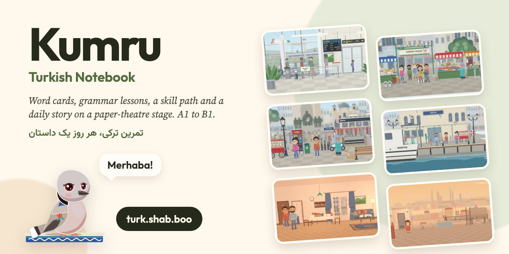

<p align="center"><a href="https://turk.shab.boo"></a></p>

<p align="center">
  <a href="https://turk.shab.boo"></a>
  <a href="https://github.com/mehrad77/kumru/actions/workflows/deploy.yml"></a>
  <a href="LICENSE"></a>
  
  
</p>

# Kumru

**Kumru · Turkish Notebook** is a practice app for the A1–B1 vocabulary and grammar of a Turkish course: word cards, grammar lessons, a skill path, and a daily story series played on a paper-theatre stage. It installs on a phone and works offline. It is named after the kumru (Eurasian collared dove). Its mascot and narrator is Kerim, a kumru; she takes her name from *yâ kerim*, the Turkish folk name for the kumru, after its coo.

Live at **https://turk.shab.boo**. An account is needed; there is no anonymous use.

- **The page** is a Vite build of `app/` (TypeScript and Preact, one folder per feature under `app/features/`).
- **The Worker** (`worker/`) serves `/api` on Cloudflare's free plan. It stores accounts, progress, Friends, classes, reminders and backups in D1 and R2.
- **The stories** (`data/stories`, `characters`, `places`, `thumbs`) play on [Sahne](https://github.com/mehrad77/sahne), the stage engine and kit, which comes in as the git submodule `sahne/`. The series is described in [docs/stories/](docs/stories/README.md).
- **The course data** (the cards, the grammar lessons, the path and the syllabus) is derived from the books, so it is private and is never in this repo. Without it the app runs on `data-sample/`: a few original cards, one lesson, one path section.

## Run it

```bash
git clone --recursive https://github.com/mehrad77/kumru && cd kumru
pnpm install
cp .dev.vars.example .dev.vars
pnpm dev            # data/ from data-sample/, then Vite + the Worker in workerd on http://localhost:8787
pnpm seed           # once: seeded accounts in the local D1
```

Then open `http://localhost:8787/?as=ada` to sign in as a seeded learner, or `?as=owner` for the owner. You need Node 24, pnpm 11 and [uv](https://docs.astral.sh/uv/) (two checks are small Python scripts).

`pnpm check` (types, lint, build, the content and story checks) and `pnpm test` (unit and Worker tests) run on the sample data. On the sample, the story check skips the rules that need the real cards and lessons, and `pnpm smoke` (the browser smoke test) needs the real data, since it uses real ids.

### Data

`scripts/data.mjs` runs before `dev`, `check`, `test`, `build`, `seed` and `smoke`. It fills the five course folders of `data/` (`cards`, `cards-extra`, `grammar`, `path`, `syllabus`), which are git-ignored:

- with private data: `KUMRU_DATA=/abs/path/to/kumru-data`, or that path on the first line of a git-ignored `.kumru-data` file, links each folder from there;
- without: each folder is a copy of `data-sample/`.

`node scripts/data.mjs --which` says which one `data/` holds. Never commit those folders or anything copied from them.

## Docs

| Doc | What it covers |
|---|---|
| [AGENTS.md](AGENTS.md) | The working guide: commands, the host contract, layout, content and page changes, production rules |
| [docs/SPECS.md](docs/SPECS.md) | The plan of record: requirements, architecture, phases 0–4, the budget |
| [docs/SPECS_API.md](docs/SPECS_API.md) | Every `/api` route: types, errors, rate limits |
| [docs/SPECS_SCHEMA.md](docs/SPECS_SCHEMA.md) | Every table, stored document, content file, backup object and device key |
| [docs/AUTH.md](docs/AUTH.md) | Kumru accounts and how Notebook connects to them (code + PKCE) |
| [docs/PROGRESS.md](docs/PROGRESS.md) | How the app decides what a learner knows: word confidence, placement, jumps, the skill tree, the Lab |
| [docs/GRAMMAR_BRIEF.md](docs/GRAMMAR_BRIEF.md) | How to write a grammar lesson |
| [docs/COSTS.md](docs/COSTS.md) | Why it should cost $0, and how to check (`/kumru-costs`) |
| [docs/stories/](docs/stories/README.md) | The story series: world, cast, calendar, authoring, schema |
| [app/README.md](app/README.md) | The browser app: feature anatomy, slots, import boundaries |
| [worker/README.md](worker/README.md) | The Worker: core, features, migrations, tests |
| [worker/seed/README.md](worker/seed/README.md) | The seeded local accounts and their progress |

Production runs `main`: `.github/workflows/deploy.yml` runs the gates on every push and pull request, and deploys `main` with the real data.

## License

The code is MIT ([LICENSE](LICENSE)). The stories, the characters and everything in `docs/stories/` are not: all rights reserved. See [NOTICE](NOTICE).
