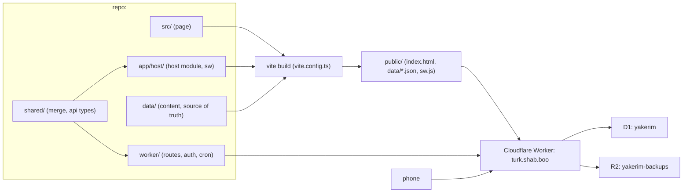

# Kumru on Cloudflare

All five phases (0–4) are built and live at turk.shab.boo. This document stays as the plan of record, and code comments cite it by section. What comes next is in the owner's roadmap (private, in the course repo).

Companion documents: [SPECS_API.md](SPECS_API.md) defines every route, its types, errors and rate limits; [SPECS_SCHEMA.md](SPECS_SCHEMA.md) defines every table, stored document, content file, backup object and device key. [AGENTS.md](../AGENTS.md) is the guide that describes the result. This file is the plan; the others are the contracts the code implements.

## 1. Requirements

### 1.1 Hard requirements

These are fixed. A phase that violates one is not done.

| # | Requirement | Where it is met |
|---|---|---|
| R1 | **$0 a month** for phases 0–3. Only Cloudflare free-plan products: Workers, static assets, D1, R2, Cron Triggers, Turnstile, Web Analytics. No API keys billed to the owner. | §12 Money; §6 client refuses AI; §10.7 the paid hook answers 402 |
| R2 | **Cloudflare replaces the artifact.** After phase 1 ships, nothing is published to claude.ai again except one final version that points at the new address. No feature keeps a dependency on `window.claude`, ArtifactData or the artifact's database. | §4 Phase 0; §6 |
| R3 | **Fresh start.** No learner data is migrated from the artifact. Accounts, progress and friend codes start empty on Cloudflare. | §4 Phase 0 |
| R4 | **Host layer only.** The page source in `src/` keeps its practice, path, stories, tutor-offline, lab and friends logic. Changes to it are limited to the host contract, the per-field timestamps the merge needs, and the new screens listed in this document. | §6; §9 |
| R5 | **The repo is the source of truth for course content.** Cards, grammar, path, stories, characters and places live under `data/` and ship as generated static files (the story collections once the Stories feature lands, ROADMAP.md M8). In-page editing comes in a later plan. The book-derived ones (cards, grammar, path, syllabus) are private: they live in the course repo and are linked into `data/` (README.md, *Data*). | §5 |
| R6 | **Real accounts.** A learner signs in on a second phone with a username and password, or by scanning a QR code from a signed-in phone, and sees the same progress. Two devices never wipe each other's answers. | §8; §9 |
| R6b | **An account comes first.** Nobody uses the app signed out: a visitor without a session sees a sign-in gate (create account, sign in, recovery code, add-a-phone code) before anything else. After the first sign-in the page and its data still work offline. | §8.7; §10.2 |
| R7 | **Installable and usable offline.** The page, its data and the learner's progress work with no network; answers given offline reach the server on the next connection. | §10.1 |
| R8 | **Learner privacy is explicit.** Learners see who can read their data, can export it and can delete their account. Nothing a learner writes is shown to others without their action (follow, join a class, opt in to the teacher view). | §8.6; §10.3; §10.5 |
| R9 | **Backed up.** Once Cloudflare is the only copy, every table is copied to R2 nightly, 30 days kept. | §10.8 |
| R10 | **Rename to Kumru.** Folder: the repo root, tools `kumru_*`, storage keys `kumru:*`. Nothing new is named kopru. | §4 Phase 0 |
| R11 | **Agent-ready codebase.** One command checks everything, one command tests everything, every generator has `--check`, every contract is typed and written down, and `AGENTS.md` is enough to start work cold. | §11 |
| R12 | **Hostname** `turk.shab.boo`, a separate Worker from the reader app on `yeni.shab.boo`, deployed by the existing GitHub workflow. | §3 |

### 1.2 Soft requirements

Wanted, and traded off against the hard ones when they conflict.

- Friends, classes, invite links, owner dashboard, hard-words report, streak reminders and reader cross-links, in that order (§10).
- A hook for a later paid tier (Gemini or another service for paying users) with no provider code now (§10.7).
- Existing dev-only query switches (`?lab`, `?fresh`, `?tree`, `?only`, `?skill`) keep working.
- The old artifact tools stay in the repo, marked deprecated, until phase 2 is live.

### 1.3 Non-goals

- AI on Cloudflare in these phases, including a capped tutor or the placement writing sample.
- Class notes, votes and learner-contributed cards. They need moderation first and return in a later plan.
- Email, magic links, Google or Apple sign-in.
- Real-time updates faster than the Friends refresh (no Durable Objects).
- Rewriting the page in a framework or moving it into the Astro app.

## 2. Architecture



- **One page, one host.** The page is built once into `public/index.html`. The host module in `app/host/index.ts` is the only code that talks to the network. It exposes the same surface the page uses today (`db.collection().onSnapshot`, `db.doc().get/set`, `user.id/me/can…`), so `src/` changes very little.
- **Content is static.** Collections that learners never write ship as JSON files under `public/data/` and are served as Workers static assets, which are free and uncounted.
- **Learner data is in D1** behind a handful of typed routes. The Worker is a thin store with ownership checks, rate limits and revision checks. It does not merge documents or parse progress; that happens in the client (§9).
- **Scheduled work** (backups, reminders) runs on Cron Triggers in the same Worker.

## 3. Hosting and deploy

- **Worker** `yakerim`, route `turk.shab.boo` (custom domain on the zone the reader app already uses). Separate from Notebook's own Worker so a reader deploy can never touch learner data and the reverse.
- **Bindings:** D1 `DB` (database `yakerim`), R2 `BACKUPS` (bucket `yakerim-backups`), assets `./public`, cron `0 * * * *` (hourly; §10.6 and §10.8 pick their hour inside).
- **Secrets** (set with `wrangler secret put`, never in the repo): `PEPPER`, `TURNSTILE_SECRET_KEY`, `VAPID_PRIVATE`. Public values (`TURNSTILE_SITE_KEY`, `VAPID_PUBLIC`) are `vars` in `wrangler.jsonc`.
- **Deploy.** [.github/workflows/deploy.yml](../.github/workflows/deploy.yml) has one job, `kumru`, on every push, pull request and manual run: it checks out the Sahne submodule, scans for tracked private data and runs gitleaks, then (when the `KUMRU_DATA_TOKEN` secret exists) sparse-checks out the private `kumru-data/` of the course repo as `KUMRU_DATA`; then `pnpm install`, `pnpm check`, `pnpm test`, and with the real data `pnpm smoke` and, on `main`, `pnpm run deploy`, which builds, applies the D1 migrations remotely and runs `wrangler deploy` with `CLOUDFLARE_API_TOKEN`. Without the token (a fork's pull request) it runs on `data-sample/` and never deploys. A failed gate blocks the deploy.
- **Local dev.** `.claude/launch.json` entry `kumru`: `pnpm dev` at the repo root, which runs the Vite dev server with the Worker in workerd, a local D1 and local R2. `pnpm seed` fills the local D1 with test accounts and progress states (§11.4). The old Python mock server `kopru_dev.py` is retired.

## 4. Phase 0 — freeze and rename

Nothing user-facing. Everything after this phase builds on a repo that owns its content and has one name.

### 4.1 Freeze the content

1. Dump the artifact's `cards` (4 cursor pages) and `grammar` with ArtifactData one last time.
2. Write them as `data/cards/<id>.json` and confirm `data/grammar/` matches the dump. Cards that exist only in the artifact (notes in `detail` and `ex`, sentences, words outside the CSVs) come across unchanged; card ids never change.
3. Change `artifact_cards.py` into `kumru_cards.py`: the same CSV→card logic, but it reads and writes `data/cards/` instead of producing batches. `--check` fails when the CSVs and the card files disagree. A word that leaves the CSVs keeps its card file with `retired: true` (ids are permanent; the build still ships retired cards so saved progress can name them, and the page hides them from new practice). `grammar_lessons.py`, `kopru_path.py` and `kopru_path_sentences.py` lose their `--batch` modes.
4. Record the dump date and the artifact's last `VERSION` in `AGENTS.md`.

### 4.2 Last artifact publish

Build one final `kopru.html` whose boot shows a full-page card: "Kumru has moved to turk.shab.boo" with the link, and nothing else. Publish it. That is the last ArtifactData or Artifact call this project makes. The artifact URL is kept in `AGENTS.md` for the record.

### 4.3 Rename

`git mv` so history survives.

| From | To |
|---|---|
| `kopru/` | the repo root |
| `tools/kopru_*.py`, `tools/kopru_*.js` | `tools/kumru_*` |
| `kopru/KOPRU.md` | `AGENTS.md` (rewritten, §11.1) |
| `kopru/kopru.html`, `VERSION` | deleted; the build output is `public/` (git-ignored) |
| `localStorage` keys `kopru:*` | `kumru:*` (fresh start, so no migration of keys) |
| launch entry `kopru-dev` | `kumru` |
| `.gitignore` `kopru/.dev/` | `public/`, `.wrangler/`, `node_modules/` |
| `AGENTS.md` (root) | points at `AGENTS.md`, the app's guide |

The deprecated artifact tools (`artifact_cards.py` and the removed `--batch` modes) are deleted at the end of phase 2, after one release has run from the frozen data.

## 5. Content data

### 5.1 Source files

```text
data/
  cards/<id>.json        one card per file (frozen from the artifact, kept in sync with the CSVs by kumru_cards.py)
  cards-extra/           the path's own starter cards (as today)
  grammar/               86 lessons (as today)
  path/s01..s18          the skill tree (as today)
  stories/ characters/ places/   the Sahne story data (SPECS_SCHEMA.md §4.1; checked by sahne/packages/sahne-story)
```

Rules:

- Every file is one document, pretty-printed JSON with sorted keys, so diffs are readable and an agent can edit one card without touching others.
- Ids are stable. `cards` ids are the artifact's; learners' progress is keyed by them (§9), so a rename is a new card plus a deprecation, never an edit of the id.
- Path sections marked `"draft": true` are built only when `vite build --mode drafts` (or `--mode dev`) is run. Production never includes them.

### 5.2 Generated files

`vite build` (`vite.config.ts`, `scripts/vite/page.ts`) writes `public/`:

- `index.html`: the shell, loading the app entry `assets/index-<hash>.js` (`app/main.ts`, which loads `app/host/index.ts` and the features' lazy chunks), with `<link rel="manifest">`, `<meta name="kumru-version">` and the service-worker registration in the head.
- `data/<collection>.<hash>.json`: one file per collection, content-hashed. `data/manifest.json` maps collection → file. The hash means a cached old page never reads new data, and a new page never reads a stale cached file.
- `sw.js` with the version and the list of files to precache.
- `manifest.webmanifest` and the icons from `brand/`.

`node scripts/check-build.mjs` builds twice into temp dirs and fails if the two builds differ or a script does not parse, so CI catches a non-deterministic build. `--mode drafts` includes draft sections for a preview deploy.

### 5.3 Validation

`kumru_data.py --check` (stdlib) validates every card, grammar lesson and path section against a JSON schema in `shared/schema/`: required fields, id patterns, `ref` matches a real unit, every `sentences` card id exists, every lesson id in a path section exists; for the stories it checks only their references (lessons, words, cast, place). The stories, characters and places get their schemas and rules from the story check (`sahne/packages/sahne-story/stories.ts --check`, SPECS_SCHEMA.md §4.1). `pnpm check` runs both. `kumru_path.py --check` and `kumru_path_sentences.py --check` keep their deeper rules.

## 6. Client host module

`app/host/index.ts` replaces `window.claude`. It defines `window.kumru.host` with the surface the page uses and nothing more: `db`, `user`, `ai`, `lib`, `update`. The boot sequence ([app/core/boot.ts](../app/core/boot.ts), [app/core/startup.ts](../app/core/startup.ts)) reads `host.db` and `host.user`. Accounts, Friends, classes, reminders and the reader's connections are not on the host: each feature calls its own routes through its `api.ts` (`app/features/<id>/api.ts`).

| Call | Behaviour |
|---|---|
| `host.ai` | `null`. [app/features/tutor/ai.ts](../app/features/tutor/ai.ts) sets the AI state to `"off"`; placement, profile clean-up, the tutor and talk use their offline paths. The `sample` name disappears from the page. |
| `user.id()` | The account's random id, or `null` before sign-in, when the page shows the sign-in gate and nothing else (§8.7). |
| `user.me()` | `{name: username, avatarUrl: ""}` |
| `user.canEdit()` | `true` only for `role = "owner"` (§10.4). The People tab and tutor lab stay hidden for everyone else. |
| `user.can("data.write")` | `false` for everyone in these phases, which turns off notes and votes through the existing `S.writable` gate. Progress still saves, because `saveProgress` checks `localOnly`, not `writable`. |
| `db.collection(<static>)` | Loads `data/<name>.<hash>.json` once from the manifest. `onSnapshot` fires once; no polling. `orderBy` and `where` run in the browser. |
| `db.collection("contrib" \| "votes")` | Empty snapshots. |
| `db.collection("profiles")` | Live through the Friends payload (§10.2); refreshed on visibility, focus, and every 2 minutes while Friends is visible. |
| `db.doc("data/users/<me>/progress")`, `…/tutor` | `GET`/`PUT /api/doc/<kind>` with revisions (§9). The Worker takes the user from the session and ignores the id in the path. |
| `db.doc("profiles/<me>")` | `PUT /api/profile`. |

Error contract: every rejected call carries `{code, message}` with codes from `shared/api.ts` (`unauthorized`, `conflict`, `rate_limited`, `too_large`, `offline`, `not_found`). The page's existing checks on `code === "invalid_argument"` become checks on `unauthorized` .

Offline: a failed `PUT` with `offline` or a 5xx keeps the doc in `localStorage` and a `kumru:dirty` flag; the next successful connection retries through the normal revision path.

## 7. D1 schema

One database, `yakerim`, built from append-only migrations in `worker/migrations/`. The DDL, every column's meaning, the JSON document shapes (progress `v: 5`, tutor, profile, weak), the static content files, the R2 layout and the device's `localStorage` keys are in [SPECS_SCHEMA.md](SPECS_SCHEMA.md). A table or column that is not in that document does not ship.

| Table | Holds | Phase |
|---|---|---|
| `users` | account, password hash, recovery hash, `role`, `plan`, time zone, soft-delete mark | 2 |
| `sessions` | one row per signed-in device: token hash, label, sliding 90-day expiry | 2 |
| `docs` | the private `progress` and `tutor` documents, one row per kind, with a revision | 2 |
| `profiles` | the public Friends document plus indexed columns `code`, `nick`, `xp`, `week`, `xp_week`, `last_day` | 2 (read by Friends from 3) |
| `follows` | the one-way follow graph, rewritten from each profile save | 2 (used from 3) |
| `pairings` | one-time QR codes for adding a phone | 2 |
| `limits` | rate-limit counters (an isolate's memory is not shared) | 2 |
| `classes`, `class_members` | classes, membership, the teacher-view opt-in | 3 |
| `push_subs` | Web Push subscriptions with time zone and hour | 4 |
| `weak` | each learner's small hard-words summary | 4 |

Rules the schema document spells out: random user ids (never the username), bodies capped at 256 KB, `week` and `last_day` stored as the client sends them so boards and reminders follow the learner's calendar, foreign keys with `ON DELETE CASCADE` from `users` so a purge is one statement, and a 7-day soft delete before that purge.

## 8. Accounts

### 8.1 Routes

Every route, with its request and response types, error codes, rate limits and the D1 rows it touches, is in [SPECS_API.md](SPECS_API.md); `shared/api.ts` implements that document. In short:

- **Auth:** `signup`, `login`, `logout`, `recover`, `password` (change), `me`, `sessions/:id` (revoke a device), `pair/start`, `pair/claim`.
- **Documents:** `GET`/`PUT /api/doc/progress` and `…/tutor` with revisions (§9).
- **Friends:** `PUT /api/profile`, `GET /api/friends`, `GET /api/profiles/search`, `GET /api/users?ids=`.
- **Classes:** create, list, join, leave, share toggle, board, members, owner management.
- **Account:** `export`, `delete`.
- **Push:** subscribe, unsubscribe, public key.
- **Owner:** `admin/stats`, `admin/weak`, `admin/users`, `admin/backups`, `admin/backup`.
- **Hook and health:** `POST /api/ai` answers 402; `GET /api/health` for CI and the dashboard; `POST /api/dev/login` exists only under `wrangler dev`.
- **Pages:** `/f/:code` and `/c/:code` serve the app with the inviter's name in the link preview.

### 8.2 Sessions

- The raw token (32 random bytes) lives in `localStorage` as `kumru:session` and is sent as `Authorization: Bearer`. The server keeps `SHA-256(token)`.
- 90 days, sliding: `expires` moves forward at most once a day, so an ordinary request is not a write.
- `label` is the user agent family, shown in Profile as "Signed-in devices" with a sign-out button per row.

### 8.3 Passwords and recovery

- PBKDF2-SHA-256 through Web Crypto, salted, with the `PEPPER` secret mixed into the password. The free plan allows 10 ms CPU per request. Measured on 2026-10-06: local workerd enforces no 100,000-iteration cap, and 100,000 iterations take about 17 ms of CPU on an M-series Mac, so `PBKDF2_ITER` started at 50,000; measured on the deployed Worker on 2026-10-07, `/api/login` took 14 ms of CPU at 50,000 (over budget), so it is now 25,000 (about 7 ms expected). `wrangler dev` does not enforce the CPU limit, so the count is tuned by reading `/api/login`'s CPU time in Workers Logs on the deployed Worker; it is stored per user in `pw_iter`, so it can change without migrating anyone.
- Recovery code: 10 random base32 characters, server-made, shown once at signup and again after a recovery. Stored as HMAC-SHA-256 under the pepper; it is random, so it needs no slow hash and costs no CPU budget.
- Username: 3–24 characters, `[a-z0-9_.]`, unique case-insensitively. Password: at least 8 characters, no other rule.

### 8.4 QR add-a-phone

A signed-in phone opens Profile → "Add a phone" and gets a one-time pairing code (12 random base32 characters, 5-minute expiry, hashed in `pairings`). It is shown as a QR of `https://turk.shab.boo/pair/<code>` and as text. The new phone scans it, the page calls `/api/pair/claim`, stores the session and reloads. Nobody types a password on a phone; the password stays as the fallback.

### 8.5 Abuse limits

- Signup: Turnstile (free) plus 5 per IP per hour.
- Login: 10 failures per username and 30 per IP per 15 minutes, then `rate_limited` with `retryAfter`.
- Pair claim: 10 per IP per hour.
- Every body: 256 KB.
- Counters live in `limits` because a Worker isolate's memory is not shared. A cron row-sweep clears old windows.

### 8.6 Privacy, export, delete

- Profile shows a short notice: progress and profile are stored on the owner's Cloudflare account; the owner can read them; nothing is shared without the learner's action.
- "Download my data" calls `/api/export`.
- "Delete my account" asks for the password, marks the account deleted, signs out every session and clears the device. After 7 days a cron deletes every row for that user.

### 8.7 Page changes (only in `src/`)

- Profile gets an **Account** card: create account, sign in, sign out, "I have a recovery code", "Change password", "Add a phone", "Signed-in devices", "Download my data", "Delete my account".
- Friends' empty-state copy points at that card instead of claude.ai.
- After signup, login or pairing the page reloads. Boot reads identity once, so the reload is what runs the existing path: an empty server doc plus a local `anon` doc uploads the anon doc ([app/features/progress/boot.ts](../app/features/progress/boot.ts)); a server doc plus an `anon` doc is merged with `shared/progress.ts` and the anon key is removed. A second device loads the server doc over its empty cache, and onboarding does not run again because `onb` is in that doc.
- **The gate.** Boot checks the session token before anything renders. Without one it shows only the gate (create account, sign in, recovery code, add-a-phone code) and stops; a `401` or sign-out reloads onto it. Offline with no session the gate says a connection is needed. Invite links (`/f/`, `/c/`, `/@name`) keep their pending code through the gate.
- Sign-out deletes the session row, `kumru:session` and `kumru:progress:<id>`, so a shared phone keeps nobody's notebook.

## 9. Sync between devices

### 9.1 The problem in today's code

`saveProgress` replaces the whole doc 1.2 seconds after the last change (`saveProgress` in [app/features/progress/api.ts](../app/features/progress/api.ts)). Last write wins. The usual collision is not two phones at once; it is a tab left open overnight that saves old state on its first answer the next day.

### 9.2 Per-field timestamps

Two small changes to the progress doc, versioned as `v: 5`:

- `confAt[id]`: the time of the last confidence change per card. `bumpConf` sets it. Today the only timestamp is `stats[id].t`, which "I already know this" (`markKnownNow`, [app/features/practice/knownNow.ts](../app/features/practice/knownNow.ts)) and the "near" bump do not touch.
- `at: {nick, char, profile, prefs, pos, placed}`: the time each of those was last set. Without them one `updated` for the whole doc lets any answer on a stale phone carry its stale prefs over the fresh ones.

`applyProgress` fills missing values from `stats[id].t` or 0 for docs with `v < 5`.

### 9.3 Revisions

- `GET /api/doc/progress` → `{rev, body}`. `GET …?since=<rev>` → 304 when unchanged, so the pull on focus is cheap.
- `PUT /api/doc/progress` with `{baseRev, body}`. If `baseRev` equals the stored `rev`, the Worker stores the body with `rev + 1` and returns the new `rev`. Otherwise it answers `409 conflict` with the current `{rev, body}`.
- The client merges its local doc with the 409 body using `shared/progress.ts` (progress) and `shared/tutor.ts` (tutor), applies the result to `S`, re-renders, and PUTs again with the new `baseRev`. The loop is bounded (3 tries) and then keeps the dirty flag for the next save.
- The Worker never parses progress bodies. Merging in the client keeps the Worker inside the free CPU budget and lets the merge be ordinary tested JavaScript.

### 9.4 Pull on focus

The host module keeps the last loaded `rev`. On `visibilitychange` to visible and on `focus`, it GETs with `since`. On a 200 it merges the server doc into `S` before the next save can go out.

### 9.5 Merge rules

`shared/progress.ts` and `shared/tutor.ts` (helpers in `shared/merge-util.ts`) are plain ES modules imported by the client and tested by `node shared/merge.test.ts`. Rules for every field `progressDoc()` writes:

| Field | Rule |
|---|---|
| `conf` | Per card, the side with the later `confAt[id]`. A plain maximum would undo wrong answers (−3) and "I already know this" undos. |
| `confAt` | Per card, the later time. |
| `stats` | Per card, the record with the later `t`; `v` (times shown) = max. |
| `drill`, `ex` | Per key, max of `r` and of `w`. Counters, so this undercounts rather than double-counts. |
| `gram` | Union. Un-marking a lesson on one phone will not stick while the other still has it. Accepted. |
| `days`, `xpDays` | Per day, max. Two phones studying the same day undercount that day. Accepted; double-counting would inflate the board. |
| `xp` | `max(a.xp, b.xp, sum(merged xpDays))` |
| `log` | Union by `(d, q, min)`, sorted by day, last 30 kept. |
| `st` (stories) | `done` wins; `stars`, `reads` = max; `picks` from the later `at`. |
| `nd` (unit path nodes) | Per node: `stars`, `n` = max; `at` = later. |
| `tree.sk`, `tree.sec` | Higher `l`, otherwise the later `at`. |
| `tree.tests` | Union by `(from, to)`. `tree.mig` = either. |
| `pos` | The later `at.pos`; ties go to the further place (A1 < A2 < B1, then unit). |
| `placed`, `onb`, `cheerSeen` | max |
| `nick`, `char`, `profile`, `prefs` | The side with the later `at.<field>`. |
| `v` | max |

The tutor doc (`mistakes`, `tries`, `talk`) has the same problem and the same route shape. It merges by union of `mistakes` by id and max per key of `tries` and `talk`.

Tests: one case per row of the table, plus "stale overnight tab", "offline answers then reconnect", "claim on A, wrong on B", "prefs changed on A, answer on B", and idempotence (`merge(a, a) == a`, `merge(a, b) == merge(b, a)` up to key order).

## 10. Features beyond parity

### 10.1 Installable offline app (phase 1)

- `brand/manifest.webmanifest` exists; the build copies it and sets `start_url` and `scope` to `/`.
- `app/host/sw.ts`: precaches `index.html`, the data files named in `data/manifest.json`, icons and fonts; network-first for `/api`, cache-first for everything else. On a new version it installs in the background and the page shows "Update ready — reload" from the existing toast.
- Progress already lives in `localStorage`; with §6's dirty flag, answers given offline are saved on the next connection. The Friends tab shows its last payload with an "offline" chip.
- `?fresh` clears the caches too.

### 10.2 Friends on D1 (phase 3)

- `GET /api/friends` returns: my profile, the profiles I follow, the profiles that follow me (from `follows`), and this week's top 50 (`WHERE week = ? ORDER BY xp_week DESC LIMIT 50`). About 100 rows read.
- `follows` is rewritten from `body.following` on each `PUT /api/profile`, so the page's one-way following model ([app/features/friends](../app/features/friends)) is unchanged and "who follows me" is an index lookup, not a scan of every profile.
- Cheers stay in the sender's profile (`cheers[<me>]`); anyone who cheers me follows me, so the followers slice covers the inbox.
- `GET /api/profiles/search?q=` : a 6-character code is one lookup on `profiles.code`; a name is `LIKE` on `username` and `nick`, 20 rows. The host module merges hits into the in-memory snapshot, because the existing search UI only shows ids already in `S.profiles`.
- Friend codes: the browser still proposes one with `frGenCode`; `code` is `UNIQUE`, and on a collision the Worker assigns a fresh code and returns the stored profile, which updates `S.myCode` on the next snapshot.
- **Invite links.** Friends gets "Share my link": `https://turk.shab.boo/f/<code>`. The Worker serves the page for `/f/*`; the host module reads the code, keeps it as `kumru:pending-follow`, and after sign-in (or at once, if signed in) follows that learner and opens Friends. The link preview carries the inviter's nick through a server-rendered `og:title`.

### 10.3 Classes (phase 3)

- **Personal link.** Each learner shares `https://turk.shab.boo/@<username>` instead of a friend code. Opening it signs in first (the gate), then shows that learner's sheet with Follow. `/f/<code>` links and friend codes keep working.

- Any learner can create a class: `POST /api/classes` `{name}` → `{id, code}` (6 characters, unique). Joining is `POST /api/classes/join` `{code}`. Leaving and, for the owner, removing a member and deleting the class.
- **Suggested classes.** New learners are offered the classes **504** and **506**, both taught by `admin`, in a step of onboarding (fixed codes `YK0504` and `YK0506`, inserted by migration `0005`). Joining there shares progress with the teacher (`share = 1`); the step says so, and Friends can turn it off. Choosing none is allowed. Existing learners do not get the step.
- **Class header.** The teacher gives a class a description, when it meets, an icon and a colour (Edit class, or when starting one); the class page shows them in its header and the lists use the icon and colour. The teacher's class page lists every member (a member sees the top 50) and opens any member's profile, with what that member shares in the teacher view. Joined classes show only Leave; the share link and **Manage class** (rename, restyle, delete) are the teacher's, and Delete lives only inside Manage class.
- **Destructive actions always ask first** (leave or delete a class, remove a member, unfollow, sign out, sign another device out): a sheet names what will happen and has a red confirm button and Cancel; deleting a class also needs its name typed. Native `confirm()` is not used.
- Friends gets a **Classes** section: my classes, each with its own weekly board (`class_members ⋈ profiles`, top 50), the class code and a share link `/c/<code>`. The Friends leaderboard switches between my friends and each of my classes (no all-learners board); a class board is the same `GET /api/classes/:id/board`, cached for 30 seconds.
- **Teacher view** is per member (`share = 1`). The join sheet shows the toggle switched on, so a learner sees it and can turn it off before joining; Profile can change it later. (`POST /api/classes/join` without `share` still stores `0`.) The class owner sees, for members who opted in, position, streak and the 10 weakest words from `weak` (§10.5). Nothing else, and never the progress doc.
- **Book progress** is a second, separate per-member switch (`share_book`), **off by default everywhere**, including the join sheet and the suggested classes. When on, the class owner also sees the member's `book` summary (SPECS_SCHEMA.md §3.7): which book units they marked done in Notebook, the share of pages read and exercise counts. Never answers, free writing or self-assessment.

### 10.4 Owner role and dashboard (phase 4)

- `users.role = 'owner'`, set once with `wrangler d1 execute`. There is no route that grants it.
- `user.canEdit()` is true for owners, which reveals the existing People tab. That tab is reworked into the **Owner** tab: signups per week, active learners (7 and 30 days), total docs and bytes, limits hits, last backup time and size, the hard-words report, and a link to the Cloudflare dashboard for request and D1 usage. The numbers come from `GET /api/admin/stats`, which is a few `COUNT` queries, not a scan of bodies.
- The tutor lab stays hidden (no AI).

### 10.5 Hard-words report (phase 4)

The Worker must not parse 3,000-card progress docs. Instead the client computes a small summary on each save: the 50 cards with the lowest accuracy and at least 3 tries, the 20 lessons with the most quiz misses (the lesson quiz records them as `ex["q:<lessonId>"]`, a one-line addition), and the counts behind them. It PUTs that as `weak` (a few KB). `GET /api/admin/weak` aggregates across learners (`json_each` over at most a few hundred small rows) and shows cards and lessons ranked by how many learners struggle with them. No per-learner data leaves `weak` except through the teacher view a member opted into.

The report links each card to its file under `data/cards/` and each lesson to `data/grammar/`, so fixing a bad example sentence is one edit and one deploy.

### 10.6 Streak reminders (phase 4)

- Onboarding ends with a **Remind me once a day at <hour>** step that asks for notification permission (default 20:00; "Not now" skips). Profile has the same control, "Remind me at <hour>", with the browser's permission prompt. The subscription (endpoint, keys), the learner's IANA time zone and the chosen hour are stored in `push_subs`.
- The hourly cron selects subscriptions whose local hour is now, whose learner has not studied today (`profiles.last_day` is before today in that zone), and sends one push with the streak count. Payloads are encrypted with a small Web Push implementation for Workers and the `VAPID_*` keys.
- A subscription that returns 404 or 410 is deleted.
- On iPhone this works only after the app is added to the home screen; the Profile copy says so.

### 10.7 Paid-tier hook (phase 4)

- `users.plan` (`free` by default) and one route, `POST /api/ai`, that answers `402 payment_required` for anyone whose plan is `free`. No provider code, no billing, no key. `AI.state` stays `off` in the page.
- The later plan that adds Gemini or another service fills in the route and the plan check; nothing in these phases is designed around it beyond that column and that route.

### 10.8 Nightly backup (phase 4, but shipped before phase 2 goes live to real learners)

- From the 03:00 UTC cron tick on, each hourly tick copies a bounded number of rows (the free plan gives a cron run 10 ms of CPU too) and records where it stopped in `backups/<YYYY-MM-DD>/state.json`; parts are `<table>.<NNN>.jsonl`, and the tick that finishes writes `manifest.json`. A lifecycle rule on the bucket deletes objects after 30 days.
- `GET /api/admin/stats` reports the last backup's time and size, and the dashboard turns the row red when it is older than 36 hours.
- `pnpm restore -- <date>` is to restore a local D1 from a backup folder for inspection, and restoring production is to be a manual step written down in `AGENTS.md`. Neither exists yet: the script is not built and the procedure is not written.
- Rows read per backup are well under the 5 million per day limit at the class sizes this is built for.

### 10.9 Reader cross-links (phase 4)

- Each card's detail view links to its word page on the reader app (`https://yeni.shab.boo/<level>/kelimeler/<slug>`), using the slug rule from `tools/vocab_csv.py` so both sites agree.
- The reader's word pages get a "Practise in Kumru" link to `https://turk.shab.boo/card/<id>`, which the host module turns into opening that card's deck. The id mapping ships as a small static file the reader already has access to, since both sites build from the same CSVs.

### 10.10 Reader notebook sync

- Notebook (`apps/reader/`, `yeni.shab.boo`) keeps a learner notebook in the browser (`apps/reader/docs/NOTEBOOK.md`). It stays a static site; a learner with a Kumru account can sync the notebook through this Worker. Routes in SPECS_API.md §11a, storage in SPECS_SCHEMA.md §2.10a and §3.6.
- **Sign-in is a redirect, not a shared cookie.** The reader sends the learner to `/connect/yeni` with its return page, a `state` and a PKCE challenge; after the sign-in gate and a consent sheet, Kumru returns a one-time code in the URL fragment, and the reader trades it (with its verifier) for a reader token: stored hashed, at most 10 per learner, revocable from either app. The token never travels in a URL, and Kumru's own session never leaves `turk.shab.boo`. [AUTH.md](AUTH.md) has the whole flow.
- The notebook is one more `docs` row (`kind = 'yeni'`, ≤ 512 KiB) with revisions; the Worker never parses or merges it.
- **One-way bridge.** The Kumru page reads the learner's own notebook (`GET /api/yeni/notebook`, read-only, no limit write) to show *In the book: …* on the Path, offer a unit's checkpoint (or a tested jump) once the learner marked that book unit done, fill the Profile banner, and compute the `book` summary for classes. It asks only when the account has a reader connection, when Path or Profile becomes visible, at most once every 10 minutes. The reader never reads Kumru data; its links into Kumru (`/unit/<REF>`) carry nothing but the unit. CORS is sent for the `YENI_ORIGINS` var only, and only on the reader's two paths (`/api/yeni/doc`, `/api/yeni/token`).
- **Budget.** The reader pulls on sign-in and when its tab becomes visible, and pushes on change (debounced about 10 s) and on `pagehide`; nothing polls. Expect 20–80 requests a day per syncing learner, so a hundred of them add 2,000–8,000 Worker requests (2–8% of the daily cap) and up to about 14,000 D1 writes (14%; each request counts one `yeni` limit write and a push writes the document). The `yeni` limit (120 per 10 minutes per learner) keeps a runaway reader's D1 work bounded, but its refused requests still count toward the Worker cap, so the cost check (`docs/COSTS.md`) watches `/api/yeni/*` in Workers Logs.
- Profile export includes the notebook and the list of connections; account deletion revokes the tokens at once and the purge removes the notebook.

## 11. Agent-ready codebase

The codebase is designed so an agent (or a person new to it) can pick up one todo, make the change, prove it works and ship it, using only what the repo says.

### 11.1 One guide per area, kept short

- `AGENTS.md` says: how to run (`pnpm dev`, `pnpm seed`), how to prove a change (`pnpm check`, `pnpm test`, the dev query switches), the host contract (the table in §6), the data contract (§7 and `shared/api.ts`), the merge rules (§9.5), the deploy path, and a gotchas list. Under 300 lines; detail lives next to the code it describes.
- The contracts live in `docs/` and are linked, not repeated: [SPECS.md](SPECS.md) is the plan, [SPECS_API.md](SPECS_API.md) every route, [SPECS_SCHEMA.md](SPECS_SCHEMA.md) every table, document and file, and [AGENTS.md](../AGENTS.md) the guide. A route, table or field that is not in them does not ship, and the document changes in the same commit as the code.
- [PROGRESS.md](PROGRESS.md) and [GRAMMAR_BRIEF.md](GRAMMAR_BRIEF.md) describe the practice rules and the lesson shapes. The story docs later moved to `docs/stories/`.
- The root `AGENTS.md` points at `AGENTS.md` and keeps only the one-paragraph summary and the tool table rows.
- Every `tools/kumru_*` script starts with a docstring that states its inputs, outputs and `--check` meaning.

### 11.2 Typed contracts in one place

- `shared/api.ts` holds every route's request and response type and the error-code union, exactly as SPECS_API.md §14 writes them. The Worker's router and the client both import it; a route added without a type does not compile.
- `shared/schema/*.json` holds the JSON schemas for content files and for the progress, tutor, profile and weak documents (SPECS_SCHEMA.md §3–§4). `kumru_data.py --check` validates content; the Worker validates bodies against the doc schemas on write (size and shape, not semantics).
- `shared/progress.ts` and `shared/tutor.ts` are the single merge implementation.

### 11.3 Small modules, one concern each

- `worker/`: `index.ts` (entry), `core/` (router, registry, http, db, limits, session, cron, sweep, health) and `features/<id>/` (routes, queries, tests, one folder per feature: account, progress, friends, classes, reminders, yeni, tutor, owner, dev); see `worker/README.md`.
- `app/host/`: `index.ts` (contract surface), `transport.ts` (fetch, auth header, offline detection), `sync.ts` (revisions, pull on focus, dirty queue), `sw.ts`.
- `app/`: `core/` (shell, router, store, boot), `host/`, `ui/`, `lib/`, `styles/` and `features/<id>/`, one folder per screen or concern, each with its own `api.ts`, `model/` and tests; see `app/README.md`.

### 11.4 Reproducible local state

- `pnpm dev` runs the Vite dev server with the Worker (`@cloudflare/vite-plugin`) and local D1 and R2; `preview_start kumru` opens it.
- `pnpm seed` creates deterministic accounts (`ada`, `ali`, `owner` with role owner; passwords in `worker/seed/README.md`) and progress states: new, mid-A1 with a streak, placed-past B1, a stale "overnight tab" doc pair, and a class with three members. Every account is reachable by `?as=ada` in dev only, which signs the dev session in without a password so an agent can verify a screen from the browser pane.
- The existing dev switches (`?lab`, `?fresh`, `?tree`, `?treedone=N`, `?only=`, `?skill=`) keep working.

### 11.5 Gates

- `pnpm check`: TypeScript, ESLint, `scripts/check-build.mjs` (two builds must match byte for byte and every script must parse), `kumru_data.py --check`, `kumru_cards.py --check`, `kumru_path.py --check`, `kumru_path_sentences.py --check`, `grammar_lessons.py --check`, `kumru_icons.py --check`, and `scripts/check-boundaries.mjs` (import boundaries between features). Migrations are checked by the Worker tests, which apply every file in `worker/migrations/` to a fresh D1.
- `pnpm test`: `node` tests for the pure modules (`tools/kumru_*.test.js` and every `*.test.ts` under `app/` and `shared/`, including `shared/merge.test.ts`), and Worker tests with `@cloudflare/vitest-pool-workers` for auth, ownership, revisions, rate limits, pairing, classes, export and delete, each against a fresh local D1.
- A browser smoke test (`pnpm smoke`, Playwright against the dev server): sign up, practise, sign in from a second context, answer on both, confirm both end on one doc. CI runs it on every deploy.
- CI order: `check` → `test` → `smoke` → migrations → deploy. A red gate blocks the deploy.
- Commits stay conventional: `feat(kumru): …`, `fix(kumru): …`, `docs(kumru): …`, one commit per concern.

### 11.6 Observability

- The Worker logs one JSON line per request (`route`, `status`, `ms`, `user` present or not, `code` on error) to Workers Logs (free tier retention). No bodies, no tokens.
- Error codes are the `shared/api.ts` union everywhere, so a log line, a test and a page message all name the same thing.
- The dashboard's "limits hits" and "last backup" rows exist so the first sign of trouble is visible without reading logs.

### 11.7 Generated files are marked and checked

Every generated file (`public/`, data manifest, `sw.js`, brand PNGs) starts with a "generated by … do not edit" line where the format allows, is git-ignored or has a `--check` that fails when stale, and has exactly one generator script.

## 12. Money

Checked against Cloudflare's pricing pages on 2026-10-06.

- **Page, data, hostname:** $0. Static-asset requests do not count toward the Worker cap; `turk.shab.boo` is a route on a zone already held.
- **Worker:** 100,000 requests a day; only `/api` and `/f/*`, `/c/*` count. No background polling, so an idle open tab costs nothing. A few hundred learners saving as they study and refreshing Friends while that tab is open stay far under the cap.
- **D1:** 5 million rows read a day, 100,000 written a day, 5 GB. A progress save writes 2–3 rows; a Friends refresh reads about 100. Past a cap, queries fail until 00:00 UTC and stored data is kept; the dashboard would show the failures.
- **R2:** 10 GB and 1 million class-A operations a month free. Nightly backups of a small class are megabytes.
- **Cron Triggers, Turnstile, Web Analytics, Workers Logs:** free tiers.
- **Web Push:** free; the push services are the browsers' own.
- **Reader notebook sync (§10.10):** about 20–80 requests and up to 140 D1 writes a day per syncing learner; a hundred such learners stay under 10% of the request cap and about 14% of the write cap.
- **If the class outgrows the free limits:** Workers Paid is $5 a month. That is the first paid step, and it is outside these phases.

## 13. Files

```text

  AGENTS.md  README.md
  docs/SPECS.md SPECS_API.md SPECS_SCHEMA.md   the plan and its contracts
  docs/PROGRESS.md GRAMMAR_BRIEF.md COSTS.md
  package.json  wrangler.jsonc  tsconfig.json  eslint.config.js
  index.html  app/main.ts
  app/core/ host/ ui/ lib/ styles/ features/<id>/
  shared/<feature>.ts api.ts progress.ts tutor.ts merge-util.ts merge.test.ts schema/*.json
  worker/index.ts worker/core/… worker/features/… worker/migrations/… worker/test/… worker/seed/
  data/cards/ cards-extra/ grammar/ path/ stories/ characters/ places/
  brand/
  public/                          generated, git-ignored
kumru_data.py kumru_cards.py kumru_icons.py
      kumru_path.py kumru_path_draft.py kumru_path_sentences.py kumru_path_specs.py
      kumru_*.test.js
.github/workflows/deploy.yml       + job kumru
.claude/launch.json                + entry kumru
```

## 14. Verification per phase

- **Phase 0:** `kumru_cards.py --check` passes against the frozen dump; `git log --follow` shows history on renamed files; the artifact shows the moved notice; nothing in the repo references `window.claude` or ArtifactData except the deprecated tools.
- **Phase 1:** `pnpm check` passes; `turk.shab.boo` serves the page; Lighthouse reports installable; airplane mode after one visit still opens the page and lets a learner practise; `scripts/check-build.mjs` is green in CI.
- **Phase 2:** Worker tests pass; `/api/login` timing on the deployed Worker is under budget at the chosen iterations; the smoke test passes; on two real phones, sign in, answer on both, and both show one doc; a tab left open overnight does not erase the other phone's morning; export downloads, delete removes.
- **Phase 3:** a code search finds a learner the board does not show; an invite link follows after signup; a class board lists only members; the teacher view shows only opted-in members.
- **Phase 4:** the dashboard loads for the owner and 404s for a learner; a backup object exists for yesterday and `pnpm restore` loads it locally; a reminder arrives at the chosen hour on an installed iPhone app and an Android browser; `/api/ai` answers 402; a card links to its reader page.

## 15. Out of scope

- AI on Cloudflare in any form, including the placement writing sample.
- Notes, votes and contributed cards (return with moderation in a later plan).
- Email, magic links, third-party sign-in.
- Durable Objects or live updates.
- In-page content editing (a later plan builds it on the owner role and `data/`).
- Migrating anything from the artifact except the course content.
